<!--
  Parth Pawar — GitHub profile.
  A risograph print poster that matches the portfolio. Every panel in ./assets
  is a self-contained SVG with the fonts baked to vector paths, so it renders
  the same everywhere. Edit scripts/build.mjs and run `npm run build`.
  stats.svg / streak.svg are live, refreshed by .github/workflows/live.yml.
-->

<a href="https://portfolio-chi-inky-84.vercel.app">
  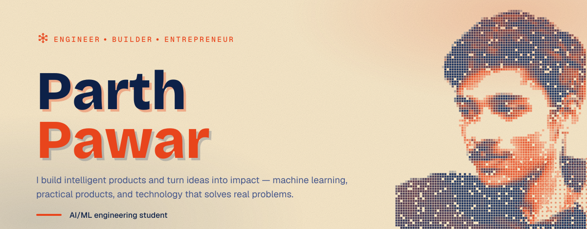
</a>

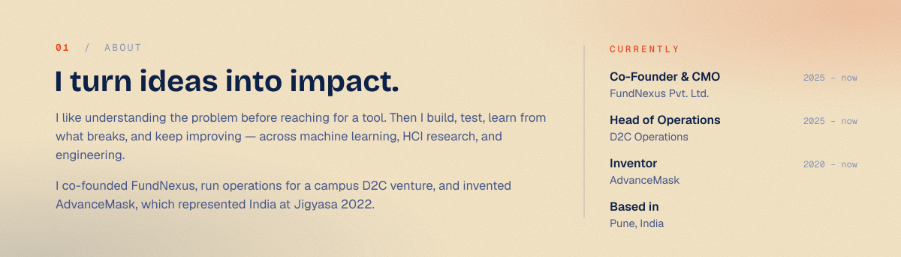

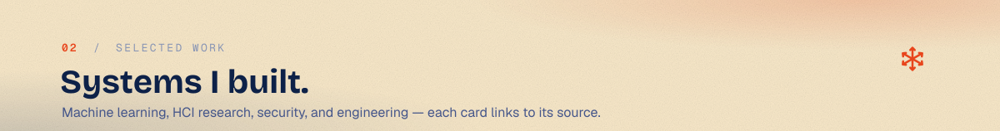

  <a href="https://github.com/parthpawarsnap11-create">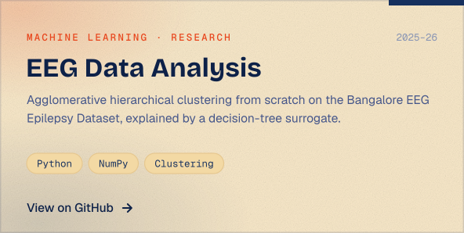</a>
  <a href="https://github.com/parthpawarsnap11-create/CampusFix">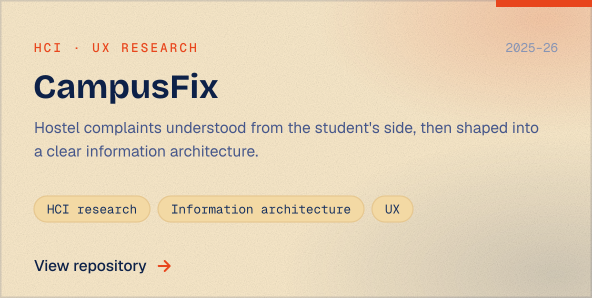</a>

  <a href="https://github.com/parthpawarsnap11-create">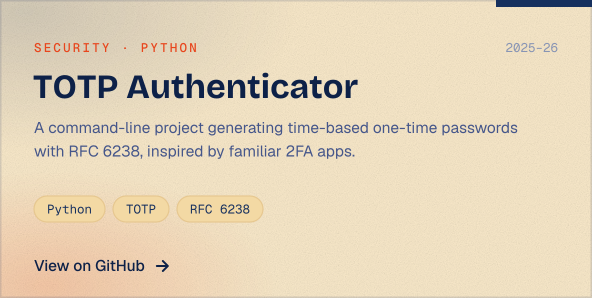</a>
  <a href="https://github.com/parthpawarsnap11-create/library-book-demand-prediction">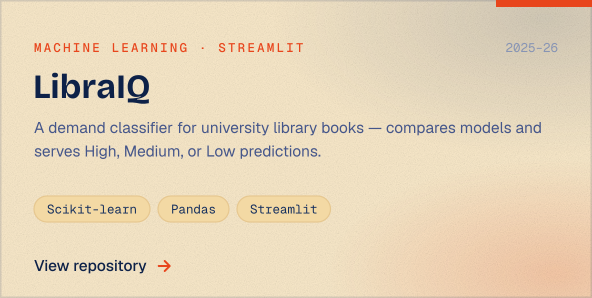</a>

  <a href="https://portfolio-chi-inky-84.vercel.app/work/advancemask">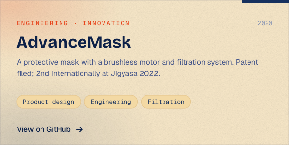</a>
  <a href="https://github.com/parthpawarsnap11-create?tab=repositories">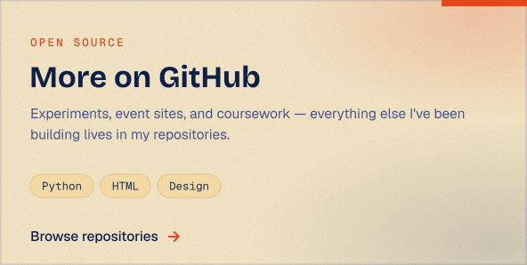</a>

<a href="https://github.com/parthpawarsnap11-create?tab=repositories">
  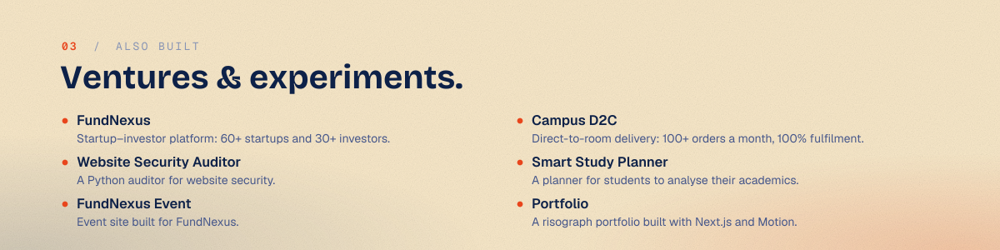
</a>

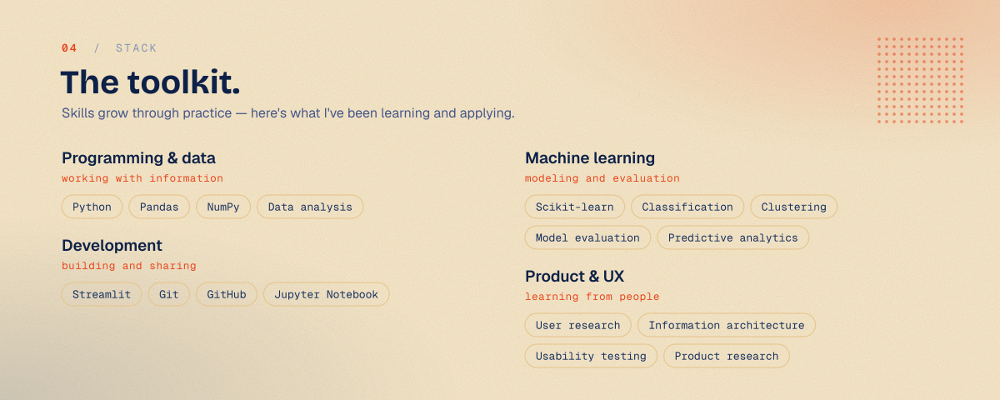

  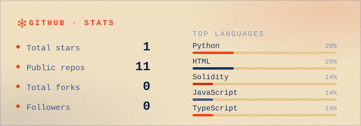
  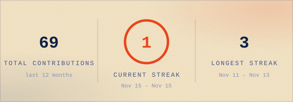

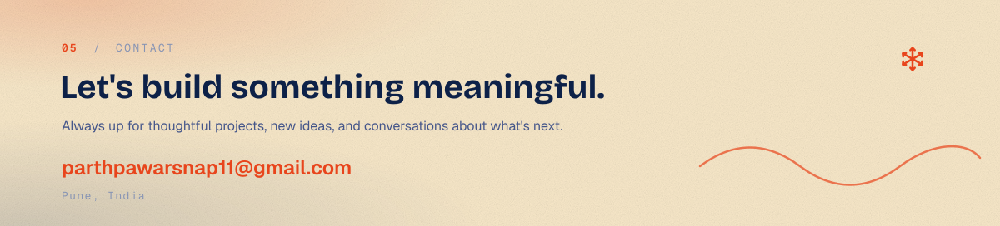

  &nbsp;
  &nbsp;
  &nbsp;
  

